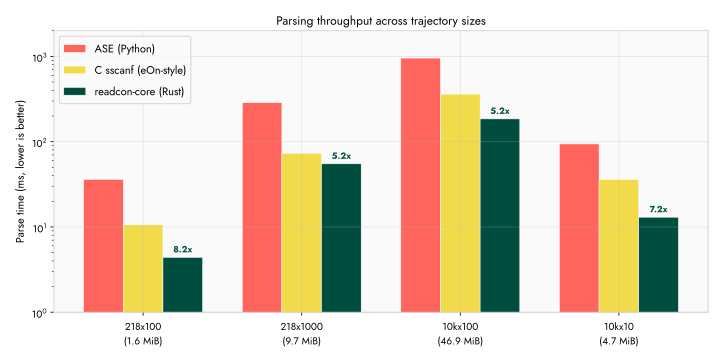
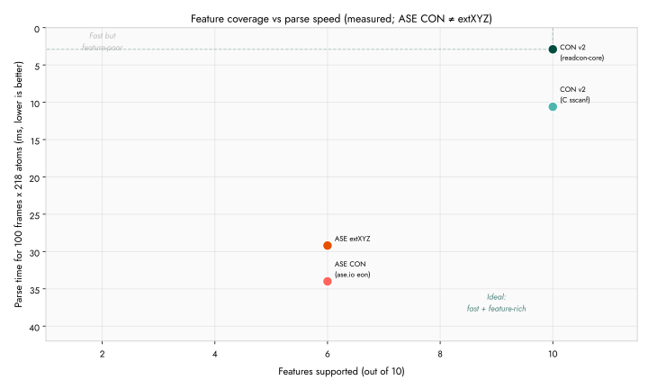
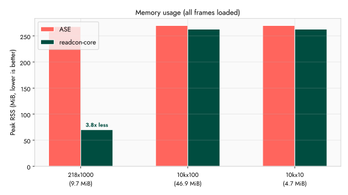
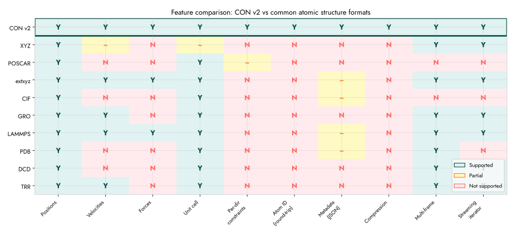

======================
Performance Benchmarks
======================

What we measure
---------------

.. table::

    +--------+----------------------------------------------------------------------------------------------+-----------------------------------------------------------------------------------+
    | Rank   | Command / artifact                                                                           | Answers                                                                           |
    +========+==============================================================================================+===================================================================================+
    | 1 (CI) | ``examples/cachegrind_harness.rs`` via ``scripts/run_cachegrind_bench.sh``                   | Instruction-count deltas on fixed CON parse / skip / write / float paths          |
    +--------+----------------------------------------------------------------------------------------------+-----------------------------------------------------------------------------------+
    | 2 (PR) | ``benchmarks/workflow/Snakefile`` drives ``asv continuous``; memory via ``asv_bench_memray`` | Python wall time and memray peak, base vs head, one runner                        |
    +--------+----------------------------------------------------------------------------------------------+-----------------------------------------------------------------------------------+
    | 3      | ``benches/compare_readers.py``                                                               | Same CON text vs ASE ``ase.io.eon`` and eOn-style C sscanf                        |
    +--------+----------------------------------------------------------------------------------------------+-----------------------------------------------------------------------------------+
    | 4      | ``benches/multiformat_traj.py``                                                              | Equal-geometry wall times: ASE XYZ/extXYZ/CON vs readcon CON                      |
    +--------+----------------------------------------------------------------------------------------------+-----------------------------------------------------------------------------------+
    | 5      | ``benches/ase_traj_vs_con.py``                                                               | ASE ``.traj`` / NetCDF / XYZ vs ``readcon.read_chemfiles`` vs native CON          |
    +--------+----------------------------------------------------------------------------------------------+-----------------------------------------------------------------------------------+
    | 6      | ``benches/h5md_vs_con.py``                                                                   | MDAnalysis H5MD / h5py positions vs CON / chemfiles XYZ                           |
    +--------+----------------------------------------------------------------------------------------------+-----------------------------------------------------------------------------------+
    | local  | ``benchmarks/workflow/weak/Snakefile`` launches asv and mpirun                               | Frames per worker stay fixed. Efficiency is t(1)/t(w).                            |
    +--------+----------------------------------------------------------------------------------------------+-----------------------------------------------------------------------------------+
    | local  | ``cargo bench`` (Criterion)                                                                  | Rust microbench latency; optional PR job saves baselines                          |
    +--------+----------------------------------------------------------------------------------------------+-----------------------------------------------------------------------------------+
    | local  | ``benches/stream_compressed.py``                                                             | Peak resident memory and wall time of Python ``iter_con`` by mode, plain and gzip |
    +--------+----------------------------------------------------------------------------------------------+-----------------------------------------------------------------------------------+

Regression gates in CI:

- **Cachegrind I-refs** — path-filtered + weekly job (``ci_cachegrind.yml``); commits
  ``docs/source/_generated/cachegrind_results.*`` on ``main`` when counts change.

- **Python ASV** — every PR (``ci_benchmark.yml``), one runner, comment via asv-perch.

Peer scripts under ``benches/`` are for local re-runs. JSON under
``benches/results/`` is what you produce when you run them — this page does not
embed host wall-clock tables.

CI Cachegrind (instruction-count gate)
--------------------------------------

Workflow ``ci_cachegrind.yml`` runs Valgrind **Cachegrind** on
``examples/cachegrind_harness.rs`` when CON-path sources (or this doc) change on
``main``, on a weekly schedule, or on manual dispatch. With
``CACHEGRIND_FEATURES=chemfiles`` it also records conversion scenarios.

Current committed include (refreshed by that job):

.. include:: _generated/cachegrind_results.rst

Reproduce (needs Valgrind):

.. code:: shell

    scripts/run_cachegrind_bench.sh
    # writes docs/source/_generated/cachegrind_results.{json,rst}

I-refs for a fixed binary are stable across noisy shared runners; wall-clock
medians on GHA are not. That is why Cachegrind is the commit-stable gate and
ASV is the PR Python surface compare.

Python ASV (PR surface)
-----------------------

Workflow ``Benchmark PR`` (``ci_benchmark.yml``) is one job. Snakemake
(``benchmarks/workflow/Snakefile``) only launches asv; it does not time the
benchmarks.

1. asv virtualenv builds **base** and **head** with
   ``maturin build --features python,chemfiles-from-sources --release``
   (pinned in ``asv.conf.json`` and ``benchmarks/workflow/requirements.txt``).
   ``ci_benchmark.yml`` pins rustc 1.88.0, the Actions by commit, uv 0.13.6,
   Python 3.12.16, and the Ubuntu 22.04 cmake, gcc, and g++ package versions.

2. Fifteen main-vs-main repetitions of the base commit, on that runner, set a
   per-benchmark noise band. Each within-run ratio is median(later)/median(earlier).
   That upper bound is the larger of the linear 99th percentile and median + 3\*median
   absolute deviation (MAD); that lower bound is the smaller of the 1st percentile and
   median - 3\*MAD when that bound is positive. Time uses ``asv run --interleave-rounds`` (twelve
   rounds of six repeats, 72 samples). Odd rounds are one side and even rounds
   the other, 36 samples a side, the same alternation as the comparison.
   Each round is its own process of one installed build. A speed shift that
   covers an odd round and the following even round cancels in their ratio,
   so that bound sits closer to 1 than a ratio of two builds. Each repetition
   also keeps the two side medians.    A second timing upper bound is a Student t
   prediction limit for a ratio of two of those medians, and the second lower
   bound is the reciprocal. The false-slowdown budget is 0.01, the complement
   of the within-run 99th percentile. That budget is split across the timing
   rows in this one comparison. The timing noise band uses the wider upper bound
   and the smaller lower bound. The limit describes a new ratio from the same
   build. An identical commit stays inside it. A rebuilt extension can move a
   short benchmark by more than that limit even when that benchmark's source
   did not change. The log also records the widest side-median ratio, the
   pairwise 99th percentile of the side-median ratios, and the
   median + 3\*MAD fence of those ratios. Three raw MADs are about 2.02
   standard deviations when the ratios are normal, because a normal MAD is
   sigma times the 75th percentile of the standard normal. Those three
   recorded numbers do not set the bound.
   The timing comparison runs after the timing repetitions and before the
   memory repetitions.
   Timing classes do not set
   ``number``. asv\_runner's default sample time is 0.01 s.
   Each sample targets that default.
   Memory classes are separate and set ``number = 1``. Memory uses successive
   one-round ``asv run`` calls, because a memray ``ray_*`` result is one peak and
   asv does not keep that scalar in ``samples`` across rounds. Odd rounds vs
   even rounds, six peaks a side. The memory upper bound is the within-run
   bound widened by one allocator granule over the median base peak. The
   granule is the usable size of a one-byte malloc. A one-byte peak change
   is one granule or less, so it stays inside the band. One extra frame,
   hundreds of bytes, is many granules and falls outside it. Timing does
   not use the granule.

3. Wall time for base vs head is ``asv continuous --interleave-rounds`` (no
   ``--quick``) in the same virtualenv, six rounds and six repeats (36 samples
   a side). Memory is the same two commits, alternating one-round runs, base
   then head.

4. ``results/comparison.txt`` calls a change significant only when the head/base
   median ratio is outside that benchmark's noise band. The table's Upper
   column is that row's bound. The same row carries N, the base median, the
   head median, and the base and head interquartile ranges. ``results/row-bounds.txt`` records the benchmark,
   the within-run upper, the between-run upper, and the upper used.
   A blank mark is not significant. ``ci_bench_commenter.yml`` posts the file via
   `asv-perch <https://github.com/HaoZeke/asv-perch>`_. Timing uses the timing
   upper bound. A memory bound of 1 does not set the timing threshold.
   The job refuses identical base and head commits. After the report is
   written, the job exits non-zero when a row is a significant slowdown or
   is missing samples. A significant speedup stays in the table.

Suite (calls shipped ``readcon`` only):

.. table::

    +----------------------+---------------------------------------------------------------------------+
    | Class                | API timed                                                                 |
    +======================+===========================================================================+
    | ``TimeReadConTiny``  | ``read_con_string`` / ``read_con`` / ``iter_con`` on multi-frame tiny CON |
    +----------------------+---------------------------------------------------------------------------+
    | ``TimeReadConCuh2``  | ``read_con`` on multi-frame ``cuh2.con`` (218 atoms/frame)                |
    +----------------------+---------------------------------------------------------------------------+
    | ``TimeChemfilesXyz`` | ``read_chemfiles`` multi-frame XYZ → ``ConFrame`` (skipped if lean)       |
    +----------------------+---------------------------------------------------------------------------+
    | ``TimeSelectAtoms``  | ``frame.select_atoms("name Cu")`` (skipped if lean)                       |
    +----------------------+---------------------------------------------------------------------------+

Timing and memory are separate classes (``Time*`` and ``Ray*``) so ``number = 1``
stays on ``ray_*`` only. Each ``time_*`` method has a matching ``ray_*`` method.
That peak is memray (``asv_bench_memray``), not asv's ``peakmem_`` / ``mem_``.

Local (same entry point as the PR job):

.. code:: shell

    # pins: benchmarks/workflow/requirements.txt
    snakemake -s benchmarks/workflow/Snakefile --cores 1 \
      --config base=HEAD~1 head=HEAD

Config: ``asv.conf.json``. Results: ``.asv/`` and ``results/`` (gitignored).

Peer scripts (host field)
-------------------------

Cite only JSON that records a host, a UTC date, a commit, and Cargo features.
The host field is the CPU model when the run stored one, and ``unrecorded``
when it did not.
``benches/results/multiformat_traj.json``, ``ase_traj_vs_con.json``, and
``h5md_vs_con.json`` are the paper-facing artifacts. A number without those
fields is a local plot, not a table.

Chemfiles ingress vs native CON is an equal-geometry wall comparison:
same atoms and frame count, XYZ through ``readcon.read_chemfiles`` versus
``readcon.read_con`` on the CON text. Cachegrind already has
``chemfiles_xyz_path`` / ``chemfiles_xyz_memory`` I-refs. The wall ratios
live in ``ase_traj_vs_con.json`` (``ratio_chemfiles_to_con_over_con``) and
``h5md_vs_con.json`` (``ratio_chemfiles_xyz_over_con``). That answers the
ingress cost. It is not a "conversion atoms/s" vanity metric: XYZ has
no constraints, ``atom_id``, or JSON, so the chemfiles path is a different
payload.

H5MD framing for the same geometry: ``h5py`` ``position/value`` is a dense
coordinate array and is faster than a full CON parse. MDAnalysis H5MD
cost is the Python ``Universe`` API, not the format. CON carries cell,
constraints, ``atom_id``, and JSON. Report all three; do not drop H5MD.

.. code:: shell

    # Same CON text vs ASE ase.io.eon and eOn-style C sscanf
    uv run --with matplotlib --with numpy --with ase python benches/compare_readers.py \
      --out benches/results/compare_readers.json

    # Equal-geometry multi-frame: ASE XYZ/extXYZ/CON vs readcon CON
    python benches/multiformat_traj.py --fixtures cuh2 --ladder 100 --repeats 5 \
      --out benches/results/multiformat_traj.json

    # ASE .traj / NetCDF / multi-frame XYZ vs chemfiles→CON vs native CON
    maturin develop --features python,chemfiles --release
    python benches/ase_traj_vs_con.py --frames 100 --repeats 5

    # H5MD via MDAnalysis / h5py vs CON (uncompressed + gzip + optional zstd size/load)
    uv pip install MDAnalysis h5py ase numpy
    python benches/h5md_vs_con.py --frames 100 --repeats 5
    # writes h5md_size_bytes, con_size_bytes, con_gz_size_bytes, con_zst_size_bytes,
    # readcon_con_ms, readcon_con_gz_ms, readcon_con_zst_ms (null if zstd feature off)

Implementation details that show up in Cachegrind and peer scripts (facts about
the code, not a promise about every host):

- Atom floats: `fast-float2 <https://github.com/aldanor/fast-float-rust>`_
  (``float_fast_float2`` vs ``float_std_parse`` Cachegrind scenarios)

- Line views: zero-copy over the input buffer (``MemchrLines``)

- Atom vectors: sized from the CON header before filling

- File load: ``read_to_string`` below 64 KiB, mmap at/above (``MMAP_THRESHOLD`` in
  ``src/compression.rs``)

- Multi-frame parallel parse: Rayon when buffer ≥ 48 KiB and ``parallel`` is on
  (``PARALLEL_BYTES_THRESHOLD`` in ``src/iterators.rs``). Sequential vs
  pinned workers: ``examples/wall_scale_harness.rs`` writes
  ``benches/results/wall_scale.json`` (host, date, commit). That JSON is
  Table io in ``paper/cpc/main.tex``. Do not mix it with the Python
  ``readcon.read_con`` wall table.

- Weak scaling grows the frame count with the worker count:
  ``n_frames = frames_per_worker * workers``. Threads and MPI ranks are
  separate curves. The ladder is every power of two from 1 through the
  physical core count, plus that count when it is not a power of two.
  Physical cores are lscpu cores per socket times sockets. Six is the
  number of serial repeats at each point. Efficiency is ``t(1)/t(w)``
  with a dashed ideal at 1.
  ``benchmarks/workflow/weak/Snakefile`` launches asv for threads and
  ``mpirun`` for ranks. Tables are named from the CPU model. The CUDA
  feature is a DLPack export, not a point on those curves.

- Skip without atoms: ``forward`` / ``forward_fast`` (Cachegrind ``forward_*``)

h5py ``position/value`` alone loads a coordinate array (not cell / constraints /
``atom_id`` / JSON). ``benches/h5md_vs_con.py`` times MDAnalysis H5MD and h5py as
**peer load paths** on equal geometry, and reports ****CON.gz / optional CON.zst****
sizes and load times next to uncompressed CON. Gzip of multi-frame CON is often
the same order as positions-only H5MD for near-repeated rare-event frames; that
is a size fact, not advice to store campaigns as H5MD instead of CON +
``readcon-db``. Compressed CON always fully decompresses before parse (no mmap);
uncompressed ≥ 64 KiB uses ``memmap2``.

Plots under ``docs/orgmode/img/`` are produced by ``benches/make_plots.py`` from
JSON you generate; regenerate after peer runs if you need them current.

    Parsing throughput (from peer JSON via ``make_plots.py``)

    Feature coverage vs parse speed (from peer JSON via ``make_plots.py``)

Public API model and hot path
-----------------------------

****Load (full frames)****

- ``read_all_frames`` / ``ConFrameIterator`` / Python ``iter_con`` / ``read_first_frame``

- Skip payload: ``count_frames`` / ``forward_fast`` when atoms are not needed

- Coordinates on a **loaded** frame: SoA / Python ``coords_array()``

- No separate public “coords-only” trajectory load

****Python****

Multi-frame parse paths release the global interpreter lock (GIL) via ``py.detach`` (``src/python.rs``) around
the Rust work; ``iter_con`` yields full frames.

Criterion (local Rust latency)
------------------------------

``cargo bench`` runs ``benches/iterator_bench.rs``. Prefer Cachegrind for I-ref
regressions and ASV for the Python PR surface. The posted PR comment is the
ASV table (``results/comparison.txt``).

Memory
------

Peak RSS depends on host and whether all frames are materialised. Streaming:

.. code:: rust

    let iter = ConFrameIterator::new(&contents);
    for result in iter {
        let frame = result?;
        // process, then drop
    }

Per frame the library keeps type symbols as shared ``Arc<str>`` (per type, not
per atom), pre-sized atom storage from headers, and parses floats from borrowed
line slices (no intermediate atom-line ``String``).

In Python, ``iter_con(path)`` keeps the whole decompressed file in memory while it iterates.
``iter_con(path, stream=True)`` keeps about one frame plus 1 MiB (mebibyte), and ``mmap=True`` keeps about 32 MiB of an uncompressed file resident on Linux.
``benches/stream_compressed.py`` runs each mode in a fresh process over a plain and a gzip file and records its wall time and peak resident set size.
The peak is read from ``VmHWM``, so the script needs Linux.

.. code:: shell

    maturin develop --release --features python
    python benches/stream_compressed.py --frames 10000 --repeats 5 --out stream.json

    Peak RSS plot (from historical peer JSON; re-run ``make_plots.py`` to refresh)

Feature matrix plot
-------------------

    CON v2 feature matrix vs common formats (``make_plots.py``)

CON v2 on the wire can carry positions, velocities, forces, unit cell,
per-direction constraints, ``atom_id``, structured JSON, compression, multi-frame
concatenation, and streaming iteration — see `spec.org <spec.rst>`_.

Statistical analysis (optional)
-------------------------------

`bayescomp <https://github.com/HaoZeke/bayescomp>`_ can fit Gamma-family models
to Criterion JSON and ``compare_readers.py`` timings when you want credible
intervals; it is not part of the PR gate.

Head to head
------------

``benchmarks/workflow/Snakefile`` target ``h2h`` runs one rule per reader.
Each rule calls an asv class under ``bench/h2h/asv/``.
The class sets ``timeout = 600`` and defines ``time_*`` and ``track_*`` methods.
Paper numbers come from those rules.
The same-file table reads one con file: readcon from C, Fortran, and Python, the upstream eon client, eon Python, and the Atomic Simulation Environment (ASE) with the eon format.
The nearest-native table reads different files that carry the same atoms and the same cell.
NumPy reads an npy coordinate array, which has no cell.
ASE and chemfiles read extended xyz.
``OVITO`` reads extended xyz.
pymatgen reads a POSCAR.
MDAnalysis reads a PDB file with a CRYST1 record.
``scripts/check_version_sot.sh`` scans the tree for the package version string.
It allows that string only in a fixed list of packaging files and in ``docs/source`` rst pages.
A file outside that list fails the scan.
The paper directory is outside the list, so a full ``cargo test`` reports those paths.
The 207 library tests do not run that scan.
A row passes only when the atom count, the cell, and the coordinates match.
NumPy has no cell, so that row fails the cell check.
The host line is Intel Xeon Processor, the ``uname -m`` value, ``nproc``, and the memory total.
Every arm is pinned with ``taskset -c 0``.
The in-process Python read and the fresh-process Python read are separate rows.
The measured medians are in ``bench/h2h/SUMMARY.md``.

Reproduce (one place)
---------------------

.. code:: shell

    # Python ASV (PR surface). Same Snakemake entry point as ci_benchmark.yml.
    snakemake -s benchmarks/workflow/Snakefile --cores 1 \
      --config base=HEAD~1 head=HEAD

    # CON peers / multi-format / traj / H5MD — see Peer scripts above

    # Plots from your JSON
    uv run --with matplotlib --with numpy python benches/make_plots.py

    # Cachegrind I-refs (needs Valgrind)
    scripts/run_cachegrind_bench.sh

    # Rust Criterion
    cargo bench
